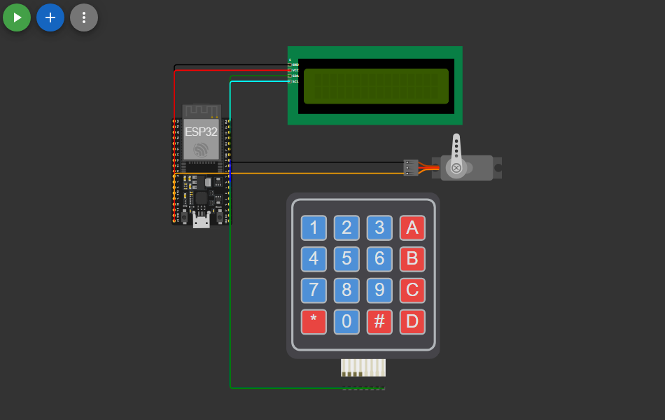
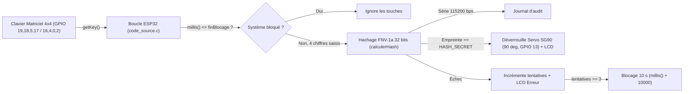
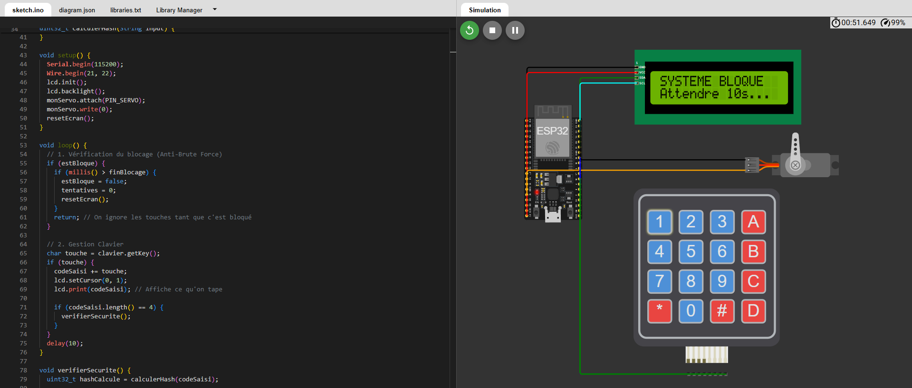

  
  

# Secure-IoT-Vault

Preuve de concept de contrôle d'accès conçue et **simulée sous Wokwi** sur ESP32 virtuel (`code_source.c`), combinant clavier matriciel 4x4, écran LCD I2C 16x2, servomoteur SG90, vérification par hachage FNV-1a et temporisation anti-bruteforce non bloquante.

> **Note :** Ce projet a été développé et testé intégralement dans le simulateur en ligne **Wokwi** (sans matériel physique ESP32).

## Contexte & Problème

Les prototypes de serrure sur microcontrôleur stockent souvent le code PIN en clair dans le firmware et bloquent l'exécution du processeur avec des appels `delay()` lors des temporisations de sécurité.

Ce PoC met en oeuvre deux mécanismes de base sur environnement contraint : éviter la comparaison de chaînes de PIN en clair et implémenter un verrouillage temporel non bloquant.

## Architecture Technique

## Choix d'Ingénierie, Sécurité & Performance

- **Comparaison par empreinte FNV-1a** : `verifierSecurite()` calcule le hash FNV-1a 32 bits (`2166136261`, premier `16777619`) du code saisi et le compare à `HASH_SECRET` (`4257489661`), sans conserver le PIN en clair dans la logique de vérification.
- **Défense anti-bruteforce non bloquante (`millis()`)** : après 3 erreurs consécutives, `estBloque` bloque toute saisie pendant 10 secondes via comparaison de `millis()`, ce qui évite de figer la boucle principale du microcontrôleur.
- **Périphériques I/O et audit série** : remontée des traces d'exécution sur UART (`115200` bauds), affichage sur LCD I2C `0x27` (`SDA=21`, `SCL=22`) et pilotage du verrou SG90 sur GPIO 13 (`0` deg fermé, `90` deg ouvert).

## Démarrage Rapide

### Composants simulés (Wokwi)

- ESP32 DevKit v1 virtuel (simulateur Wokwi)
- Clavier matriciel 4x4 virtuel sur `{19, 18, 5, 17}` (lignes) et `{16, 4, 0, 2}` (colonnes)
- Écran LCD 16x2 I2C virtuel (`0x27`, broches 21/22)
- Servomoteur SG90 virtuel sur GPIO 13

### Exécution de la simulation

1. Ouvrir `code_source.c` dans un projet ESP32 sous Wokwi (ou Arduino IDE / PlatformIO).
2. Ajouter les bibliothèques `Keypad`, `LiquidCrystal_I2C` et `ESP32Servo`.
3. Lancer la simulation Wokwi.
4. Saisir le code démo par défaut (`1234`) pour déverrouiller le servo à `90` degrés, ou entrer 3 codes faux pour déclencher le blocage de 10 secondes.

## Pistes d'Amélioration

- Remplacer FNV-1a (hash non cryptographique exposé au cassage hors ligne sur 4 chiffres) par un HMAC-SHA256 salé via mbedTLS sur ESP32 et retirer l'affichage du code en clair dans les logs série en production.
- Persister le compteur d'échecs dans la mémoire NVS de l'ESP32 pour résister à un redémarrage matériel (power-cycling).
- Supprimer les `delay(2000)` / `delay(3000)` restants dans `verifierSecurite()` via une machine à états complète et ajouter un `diagram.json` / `wokwi.toml` versionné pour lancer la simulation directement.
