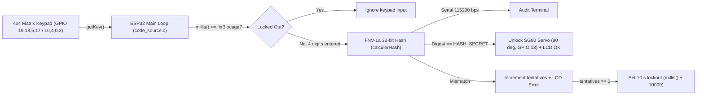

  
  

# Secure-IoT-Vault

Access control proof of concept built and **simulated in Wokwi** on a virtual ESP32 (`code_source.c`), combining a 4x4 matrix keypad, I2C 16x2 LCD, SG90 servo lock, FNV-1a PIN verification, and non-blocking anti-brute-force protection.

> **Note:** This project was developed and tested entirely inside the **Wokwi** online simulator (no physical ESP32 hardware was used).

## Context & Problem

Entry-level microcontroller lock prototypes frequently hardcode plaintext PIN strings in firmware and stall execution with blocking `delay()` loops during lockouts.

This PoC demonstrates two baseline defensive patterns within constrained MCU firmware: avoiding plaintext secret literals in comparisons and enforcing an attack cooldown using non-blocking timestamp checks.

## Technical Architecture

## Engineering Choices, Security & Performance

- **No plaintext PIN in comparison logic**: `verifierSecurite()` computes the 32-bit FNV-1a hash (`offset=2166136261`, `prime=16777619`) of the 4-character input and compares it against `HASH_SECRET` (`4257489661`).
- **Non-blocking anti-brute-force (`millis()`)**: After 3 consecutive failures, `estBloque` triggers a 10-second lockout timed with `millis()`. Using timestamp comparison instead of a 10 s `delay()` keeps the main loop responsive without stalling MCU tasks.
- **Hardware I/O & Serial audit**: Logs every attempted code and computed hash over UART (`115200` baud) while driving the `0x27` I2C 16x2 LCD (`SDA=21`, `SCL=22`) and the SG90 actuator on GPIO 13 (`0` deg locked, `90` deg unlocked).

## Quick Start

### Simulated Components (Wokwi)

- Virtual ESP32 DevKit v1 (Wokwi simulator)
- Virtual 4x4 membrane keypad wired to `{19, 18, 5, 17}` (rows) and `{16, 4, 0, 2}` (cols)
- Virtual 16x2 I2C LCD (`0x27`, pins 21/22)
- Virtual SG90 servo motor on GPIO 13

### Run Simulation

1. Open `code_source.c` in a Wokwi ESP32 project (or Arduino IDE / PlatformIO).
2. Add the libraries: `Keypad`, `LiquidCrystal_I2C`, and `ESP32Servo`.
3. Start the Wokwi simulation.
4. Enter the default demo PIN (`1234`) to rotate the servo to `90` degrees, or enter 3 wrong codes to verify the 10-second lockout.

## Future Improvements

- Replace FNV-1a (a fast non-cryptographic hash vulnerable to offline guessing on 4-digit PIN spaces) with salted SHA-256 / HMAC using mbedTLS on ESP32 and remove plaintext input from UART audit logs in production mode.
- Persist failed attempt counters and lockout state in ESP32 NVS (flash) so power cycling cannot reset brute-force limits.
- Remove remaining `delay(2000)` / `delay(3000)` calls in `verifierSecurite()` in favor of a full finite-state machine, and add a `wokwi.toml` / `diagram.json` for one-click headless CI simulation.
