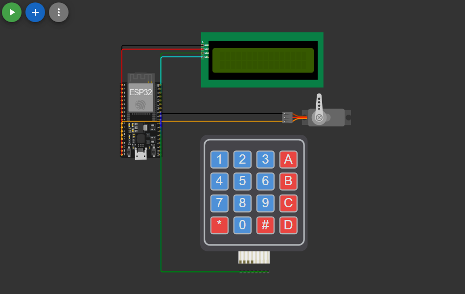
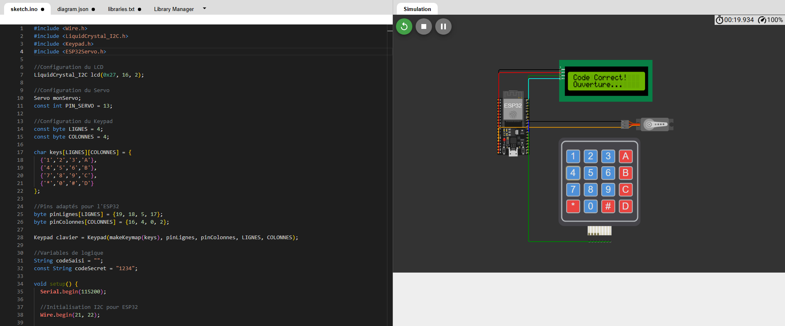
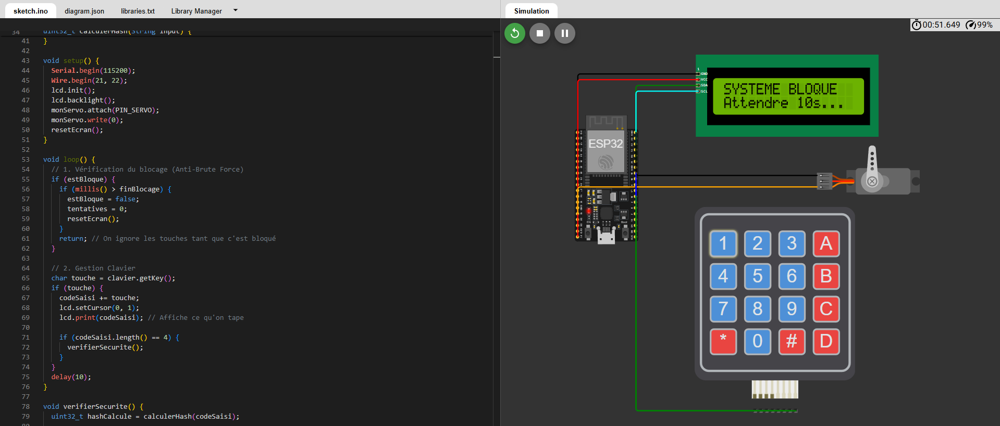

# Secure-IoT-Vault (ESP32)

## Description
**Secure-IoT-Vault** est une preuve de concept (PoC) d'un système de contrôle d'accès cyber-physique. 
L'objectif de ce projet est de démontrer comment sécuriser un système embarqué critique à ressources limitées (microcontrôleur) en évitant les failles de sécurité classiques (mots de passe en clair, attaques par force brute).

Ce projet fait le pont entre le **développement logiciel (C++)**, la **cybersécurité algorithmique**, et la **robotique/électronique**.

## Fonctionnalités Cyber & Logicielles

### 1. Zero-Knowledge Proof (Hachage FNV-1a)
Le code PIN n'est jamais stocké en clair dans la mémoire de l'ESP32. Le système utilise l'algorithme de hachage non-cryptographique FNV-1a (XOR et arithmétique modulaire) pour comparer les empreintes numériques.

### 2. Défense Anti-Brute Force
Implémentation d'un "lockout" temporel. Après 3 tentatives échouées consécutives, le système ignore les entrées matérielles pendant 10 secondes (gestion via `millis()` pour ne pas bloquer le processeur).

### 3. Audit en Temps Réel
Remontée des logs (Inputs et Hash calculés) via liaison série pour la supervision.

## Stack Technique & Matériel
* **Microcontrôleur :** ESP32 (DevKit)
* **Langage :** C++ (Framework Arduino)
* **Composants physiques :** * Servomoteur SG90 (Simule le verrou physique)
  * Écran LCD 16x2 (via module I2C)
  * Clavier Matriciel 4x4 (Membrane Keypad)

## Comment tester la simulation (Wokwi)
Ce projet est entièrement simulé et testable directement dans le navigateur via Wokwi.

1. Cliquez sur le lien de simulation : *(Insère ici ton lien Wokwi "Share")*
2. Lancez la simulation (Bouton Play).
3. Entrez le code correct (`1234` par défaut) pour voir l'actionneur se déverrouiller.
4. Entrez un code erroné 3 fois de suite pour tester le verrouillage de sécurité anti-bruteforce.

## Architecture du Code
Le code est structuré de manière non-bloquante pour permettre au microcontrôleur de traiter les entrées du clavier tout en vérifiant les timeouts de sécurité en arrière-plan.
